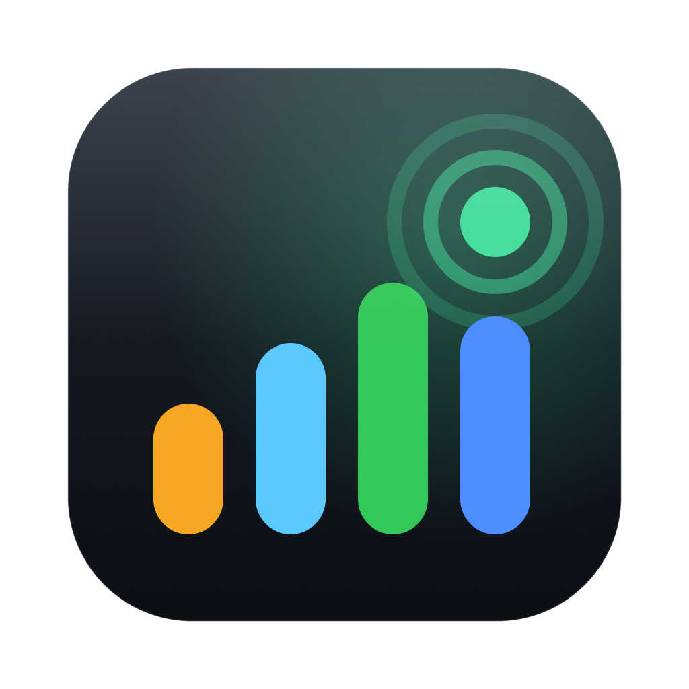
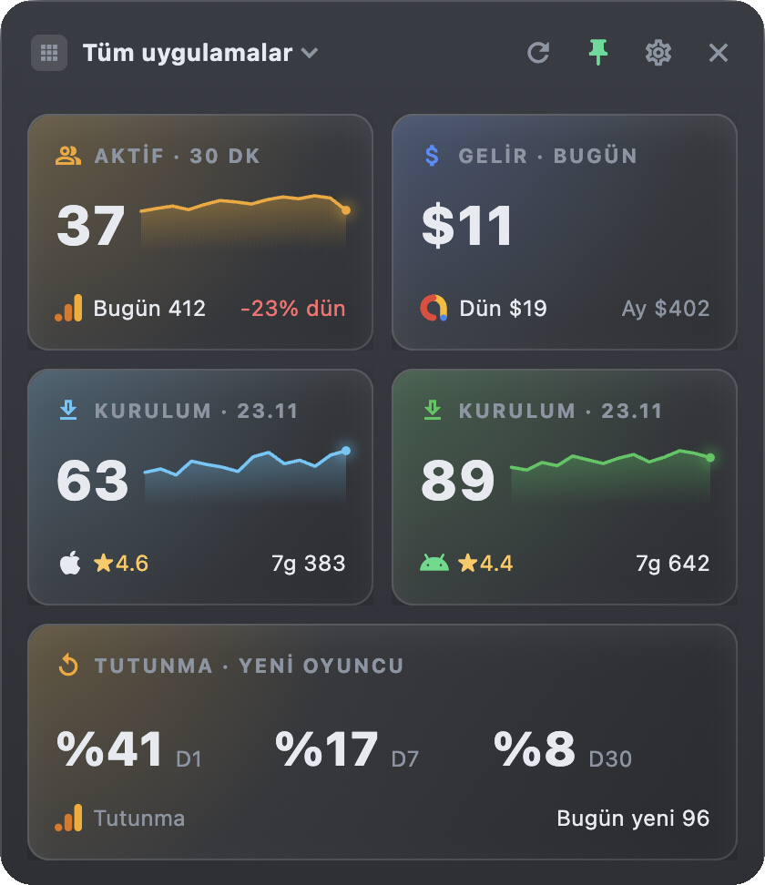

<p align="center">
  
</p>

<h1 align="center">App Signal</h1>

<p align="center">
  Uygulama geliştiricileri için küçük bir masaüstü penceresi.<br>
  Google Analytics 4, App Store Connect, Google Play ve AdMob rakamlarınız tek yerde.
</p>

<p align="center">macOS · Windows · <a href="#english">English</a></p>

<p align="center">
  
</p>

---

## Ne yapar

- Aktif kullanıcı, indirme, yorum ve reklam geliri tek pencerede.
- Pencere masaüstünde açık kalır, rakamlar kendiliğinden yenilenir.
- Veriler Google ve Apple'dan doğrudan bilgisayarınıza gelir. App Signal'in sunucusu yoktur.
- Mağaza gelirini dolara çevirmek için döviz kurları günde birkaç kez [open.er-api.com](https://open.er-api.com)'dan alınır. Bu istekte sizinle ilgili hiçbir veri gönderilmez.
- Google erişimi yalnız okuma içindir (`analytics.readonly`, `admob.readonly`, `devstorage.read_only`). Play kurulum, gelir ve yorumları Play Console'un rapor deposundan okunur; yorumlar günde bir güncellenir.
- Anahtarlar ve giriş jetonları yalnız işletim sisteminin şifre kasasında saklanır.

## Kaynaklar

| Kaynak | Bağlantı |
| --- | --- |
| Google Analytics 4 | Google ile giriş ya da servis hesabı JSON'u |
| AdMob | Google ile giriş |
| App Store Connect | API anahtarı (`.p8`), Key ID, Issuer ID |
| Google Play | Rapor kovası + Google ile giriş ya da servis hesabı JSON'u |

Bir kaynağı Ayarlar'dan istediğiniz an ayırabilirsiniz.

## Kaynaktan derleme

Gerekenler: Flutter (Dart `^3.13`), macOS için Xcode, Windows için Visual Studio.

```bash
flutter pub get
flutter run -d macos
```

**Google ile giriş** için kendi OAuth istemcinizi ekleyin:

1. Google Cloud'da Analytics Data API, Analytics Admin API, AdMob API ve Cloud Storage API'yi açın.
2. Kimlik bilgileri bölümünde "Masaüstü uygulaması" türünde OAuth istemcisi oluşturun.
3. JSON'u indirip `assets/admob_oauth_client.json` olarak kaydedin. Bu dosya `.gitignore`'da; repoya girmez.

Dosya olmadan da uygulama çalışır; GA4 ve Play için JSON dosyası seçebilirsiniz.

## Gizlilik

[Gizlilik politikası](https://ilkayderici.com.tr/app-signal-gizlilik.html)

---

<a id="english"></a>

## English

A small desktop window for app developers. It shows your own numbers from Google Analytics 4, App Store Connect, Google Play and AdMob in one place.

- Active users, downloads, reviews and ad revenue in one window.
- Data goes straight from Google and Apple to your computer. App Signal has no server.
- To convert store revenue to USD, exchange rates are fetched from [open.er-api.com](https://open.er-api.com) a few times a day. That request sends no data about you.
- Google access is read-only (`analytics.readonly`, `admob.readonly`, `devstorage.read_only`). Play installs, revenue and reviews come from Play Console's report bucket; reviews update once a day. Keys and tokens are stored only in the OS keychain.

**Build:** `flutter pub get && flutter run -d macos`. For Google sign-in, create a Desktop OAuth client in Google Cloud and save its JSON as `assets/admob_oauth_client.json` (gitignored).

[Privacy policy](https://ilkayderici.com.tr/app-signal-gizlilik.html)
